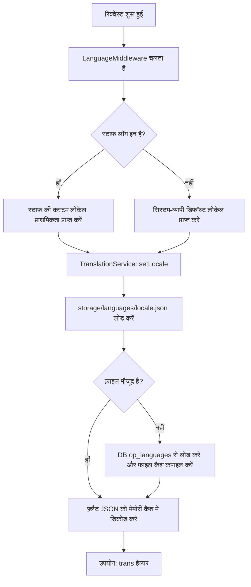

OwnPay में एक अंतर्राष्ट्रीयकरण (i18n) और स्थानीयकरण आर्किटेक्चर है जो एक स्थानीयकृत प्रशासनिक पैनल और व्हाइट-लेबल, ग्राहक-सामने वाले चेकआउट इंटरफ़ेस प्रदान करता है। यह गाइड अनुवाद सिस्टम, लोकेल रिज़ॉल्यूशन फ़्लो, PHP कोड और Twig टेम्पलेट में उपयोग, और आप अनुवाद कैटलॉग में कैसे योगदान दे सकते हैं या उन्हें कैसे प्रबंधित कर सकते हैं, इसे कवर करती है।

---

## 1. कोर आर्किटेक्चर {#1-core-architecture}

OwnPay भाषा अनुवाद फ़ाइलों के लिए एक हाइब्रिड **डेटाबेस-और-फ़ाइलसिस्टम** स्टोरेज पैटर्न का उपयोग करता है, ताकि चेकआउट हॉट-पाथ के दौरान उच्च प्रदर्शन सुनिश्चित हो और साथ ही Admin Panel से रन-टाइम पर डायनामिक समायोजन की अनुमति मिले।



### 1.1 अनुवाद स्टोरेज {#1-1-translation-storage}
* **डेटाबेस टेबल (`op_languages`)**:
  भाषा प्रोफ़ाइल और अनुवाद कैटलॉग संग्रहीत करती है। इसमें निम्नलिखित कॉलम होते हैं:
  * `code` (VARCHAR): ISO 639-1 भाषा कोड (उदा., `en`, `bn`, `es`)।
  * `name` (VARCHAR): भाषा का मानव-पठनीय नाम (उदा., `English`, `Bengali`, `Spanish`)।
  * `status` (ENUM): भाषा की स्थिति (`active`, `inactive`)। केवल सक्रिय भाषाओं को ही सिस्टम द्वारा रिज़ॉल्व किया जा सकता है।
  * `is_default` (TINYINT): सिस्टम-व्यापी फ़ॉलबैक डिफ़ॉल्ट भाषा का संकेतक।
  * `translations` (JSON): फ़्लैट अनुवाद की-वैल्यू मैपिंग का कैटलॉग।
* **फ़ाइलसिस्टम कंपाइलेशन (`storage/languages/`)**:
  उच्च-थ्रूपुट पेमेंट चेकआउट पर डेटाबेस क्वेरी के ओवरहेड को रोकने के लिए, जब एडमिन पैनल में कोई भाषा बनाई, अपलोड या सहेजी जाती है, तो अनुवाद तुरंत `storage/languages/{code}.json` में कंपाइल किए जाते हैं।
* **बेस अंग्रेज़ी फ़ॉलबैक (`config/languages/`)**:
  अंग्रेज़ी (`en`) बेस डिफ़ॉल्ट लोकेल और फ़ॉलबैक के रूप में कार्य करती है। मास्टर फ़ाइल `config/languages/en.json` पर रखी जाती है। यदि कंपाइल किया गया फ़ाइलसिस्टम कैश `storage/languages/en.json` मौजूद नहीं है या हटा दिया गया है, तो सिस्टम `config/languages/en.json` से सामग्री कॉपी करके इसे स्वचालित रूप से पुनर्प्राप्त कर लेता है।

---

## 2. लोकेल रिज़ॉल्यूशन पाइपलाइन {#2-locale-resolution-pipeline}

लोकेल रिज़ॉल्यूशन HTTP रिक्वेस्ट लाइफ़साइकल में [LanguageMiddleware](https://github.com/own-pay/OwnPay/blob/main/src/Middleware/LanguageMiddleware.php) द्वारा प्रबंधित किया जाता है:

1. **ग्लोबल डिफ़ॉल्ट जाँच**: सक्रिय डिफ़ॉल्ट भाषा के लिए डेटाबेस से क्वेरी करके डिफ़ॉल्ट सिस्टम भाषा रिज़ॉल्व करता है (निर्दिष्ट न होने पर `en` पर फ़ॉलबैक)।
2. **स्टाफ़ उपयोगकर्ता प्राथमिकता**: यदि कोई प्रशासनिक स्टाफ़ उपयोगकर्ता लॉग इन है, तो मिडलवेयर उनकी स्पष्ट उपयोगकर्ता प्राथमिकता के लिए `op_merchant_users` टेबल के `language` कॉलम से क्वेरी करता है।
3. **कॉन्टेक्स्ट बाइंडिंग**: रिज़ॉल्व किए गए लोकेल को `setLocale()` के माध्यम से `TranslationService` से बाइंड किया जाता है, जिससे कोई भी पुराना इन-मेमोरी अनुवाद कैश साफ़ हो जाता है।

---

## 3. अनुवाद कुंजी फ़ॉर्मेटिंग {#3-translation-key-formatting}

OwnPay अनुवाद कुंजियों के लिए एक फ़्लैट, डॉट-नोटेशन फ़ॉर्मेट लागू करता है।

### 3.1 डॉट-नोटेशन {#3-1-dot-notation}
नेस्टेड JSON संरचनाओं के माध्यम से अपलोड किए गए भाषा ऐरे को डॉट-नोटेशन का उपयोग करके स्वचालित रूप से एकल-स्तरीय की-वैल्यू मैप में फ़्लैट कर दिया जाता है। उदाहरण के लिए, निम्नलिखित नेस्टेड JSON:
```json
{
    "menu": {
        "dashboard": "Dashboard",
        "payments": "Payments"
    },
    "common": {
        "actions": {
            "save": "Save Changes"
        }
    }
}
```
को फ़्लैट करके आंतरिक रूप से इस प्रकार संग्रहीत किया जाता है:
```json
{
    "menu.dashboard": "Dashboard",
    "menu.payments": "Payments",
    "common.actions.save": "Save Changes"
}
```

### 3.2 प्लेसहोल्डर और प्रतिस्थापन {#3-2-placeholders-&-replacements}
अनुवाद स्ट्रिंग के भीतर डायनामिक पैरामीटर की पहचान एक अग्रणी कोलन (`:`) से होती है।
```json
{
    "language.confirm_delete": "Are you sure you want to delete :name?",
    "payment.charge_success": "Successfully charged :amount :currency"
}
```

---

## 4. PHP कोड में उपयोग {#4-usage-in-php-code}

PHP क्लासों (Controllers, Services, Repositories) के भीतर अनुवाद का उपयोग करने के लिए, PSR-11 डिपेंडेंसी कंटेनर से [TranslationService](https://github.com/own-pay/OwnPay/blob/main/src/Service/System/TranslationService.php) प्राप्त करें:

```php
declare(strict_types=1);

namespace OwnPay\Controller\Admin;

use OwnPay\Http\Request;
use OwnPay\Http\Response;
use OwnPay\Service\System\TranslationService;

final class SettingsController extends BaseController
{
    public function save(Request $req): Response
    {
        /** @var TranslationService $transSvc */
        $transSvc = $this->c->get(TranslationService::class);

        // Simple translation lookup
        $successMsg = $transSvc->trans('language.success_save');

        // Translation lookup with placeholder replacements
        $deleteConfirm = $transSvc->trans('language.confirm_delete', [
            'name' => 'Bengali'
        ]);

        $this->session->flashSuccess($successMsg);
        return Response::redirect('/admin/settings/language');
    }
}
```

### 4.1 फ़ॉलबैक नियम {#4-1-fallback-rules}
जब `$translationService->trans($key)` को कॉल किया जाता है:
1. यह सक्रिय लोकेल (उदा. `bn`) के लिए कैश किए गए अनुवादों में खोज करता है।
2. यदि कुंजी मौजूद नहीं है या खाली है, तो यह बेसलाइन अंग्रेज़ी (`en`) कैटलॉग पर फ़ॉलबैक करता है।
3. यदि कुंजी अंग्रेज़ी में भी मौजूद नहीं है, तो शाब्दिक `$key` स्ट्रिंग लौटाई जाती है।

---

## 5. टेम्पलेट और चेकआउट थीम में उपयोग {#5-usage-in-templates-&-checkout-themes}

### 5.1 एडमिन टेम्पलेट {#5-1-admin-templates}
एडमिन व्यू रनटाइम के दौरान लोड किए गए बेस अनुवादों का उपयोग करते हैं। आप अनुवादित स्ट्रिंग्स को सीधे Twig टेम्पलेट में बाइंड कर सकते हैं।

### 5.2 चेकआउट टेम्पलेट {#5-2-checkout-templates}
चेकआउट व्यू (उदा. `templates/checkout/checkout.twig`) व्हाइट-लेबल इंटरफ़ेस का प्रतिनिधित्व करते हैं जहाँ मर्चेंट मानक संदेशों को कस्टमाइज़ कर सकते हैं।
* ग्राहक-सामने वाले टेम्पलेट `lang` व्यू वेरिएबल के माध्यम से अनुवाद और ब्रांडिंग स्ट्रिंग्स तक पहुँचते हैं:
  ```twig
  <p class="st-subtitle">
      {{ lang.success_msg ?? 'Your transaction has been processed successfully.' }}
  </p>
  ```
* ये वेरिएबल [BrandThemeService](https://github.com/own-pay/OwnPay/blob/main/src/Service/Brand/BrandThemeService.php) द्वारा सक्रिय ब्रांड प्रोफ़ाइल, मेटाडेटा ओवरराइड या सिस्टम-व्यापी डिफ़ॉल्ट सेटिंग्स से भरे जाते हैं।

---

## 6. अनुवाद प्रशासन {#6-translation-administration}

सुपर-एडमिनिस्ट्रेटर Admin Sidebar में **System → Settings → Language** के अंतर्गत स्थानीयकरण सेटिंग्स प्रबंधित कर सकते हैं:

1. **डिफ़ॉल्ट भाषा चुनें**: उन सभी सेशन के लिए डिफ़ॉल्ट फ़ॉलबैक भाषा सेट करता है जिनमें कोई विशिष्ट स्टाफ़ लोकेल ओवरराइड नहीं है।
2. **मैन्युअल रूप से भाषा जोड़ें**: एक नई भाषा प्रोफ़ाइल रजिस्टर करता है। सिस्टम डिफ़ॉल्ट अंग्रेज़ी (`en`) स्ट्रिंग्स को क्लोन करके इस भाषा के लिए अनुवाद कैटलॉग प्रारंभ करता है।
3. **अनुवाद फ़ाइल अपलोड करें**: अनुवाद स्ट्रिंग्स वाली एक JSON फ़ाइल इम्पोर्ट करता है (फ़्लैट या नेस्टेड डिक्शनरी का समर्थन करता है)।
4. **स्ट्रिंग्स का अनुवाद करें (इनलाइन एडिटर)**: अनुवादों को पंक्ति-दर-पंक्ति संपादित करने के लिए एक इंटरैक्टिव की-वैल्यू फ़ॉर्म।
5. **भाषा हटाएँ**: बेस अंग्रेज़ी (`en`) कॉन्फ़िगरेशन को छोड़कर सभी भाषाओं के लिए अनुमत। किसी भाषा को हटाने से डेटाबेस से संबंधित रिकॉर्ड हट जाते हैं और उसकी फ़ाइलसिस्टम कैश फ़ाइल भी हटा दी जाती है।

---

## 7. अनुवाद में योगदान {#7-contributing-translations}

भाषा अनुवाद जोड़ने या अपडेट करने के लिए पुल रिक्वेस्ट सबमिट करते समय:

### चरण 1: अनुवाद कैटलॉग बनाएँ {#step-1-create-the-translation-catalog}
डॉट-नोटेशन का उपयोग करके एक अनुवाद JSON फ़ाइल बनाएँ। प्लेसहोल्डर (`:` उपसर्ग वाले) अपरिवर्तित रहने चाहिए (उदा., `:name`, `:amount` के कोलन बने रहने चाहिए)।
उदाहरण `es.json` (स्पैनिश):
```json
{
    "menu.dashboard": "Tablero",
    "common.save": "Guardar cambios",
    "language.confirm_delete": "¿Está seguro de que desea eliminar :name?"
}
```

### चरण 2: कैटलॉग टेस्ट करें {#step-2-test-the-catalog}
1. सेटिंग्स में **Upload Translation File** पैनल के माध्यम से अपनी JSON फ़ाइल अपलोड करें।
2. सत्यापित करें कि स्ट्रिंग्स पूरे एडमिन इंटरफ़ेस में सही ढंग से प्रदर्शित होती हैं।
3. उपयोगकर्ता-विशिष्ट मिडलवेयर रिज़ॉल्यूशन सत्यापित करने के लिए **Account → My Account** के अंतर्गत अपनी स्टाफ़ उपयोगकर्ता भाषा को नई अपलोड की गई भाषा पर स्विच करें।

### चरण 3: डिफ़ॉल्ट कॉन्फ़िग अपडेट करें (कोर भाषाओं के लिए) {#step-3-update-default-config-for-core-languages}
यदि आप ऐसे अनुवाद का योगदान कर रहे हैं जिसे OwnPay के साथ मूल रूप से शिप होना चाहिए, तो फ़ाइल को अपनी ब्रांच की `config/languages/` डायरेक्टरी में रखें (उदा., `config/languages/es.json`) और GitHub पर एक पुल रिक्वेस्ट सबमिट करें।
