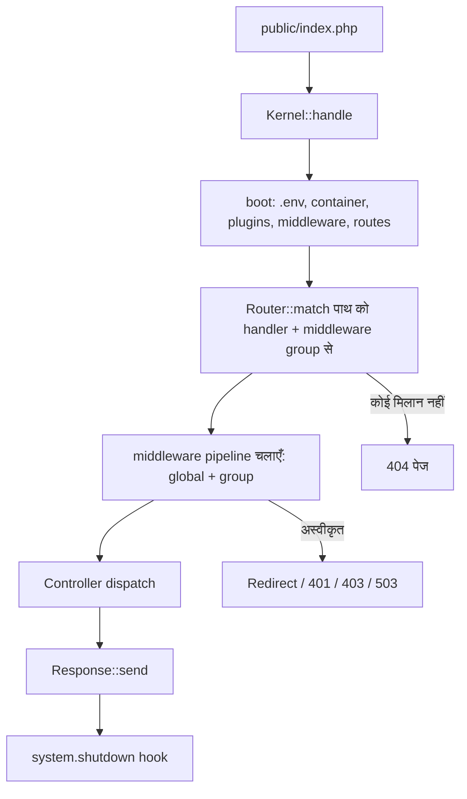
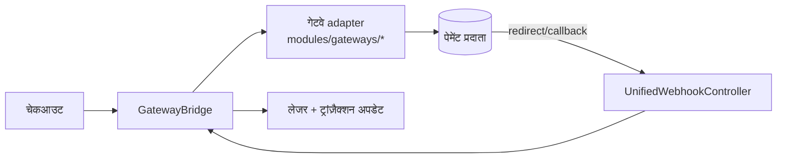

**OwnPay** कैसे बना है, इस पर एक डेवलपर गाइड - योगदानकर्ताओं और इंटीग्रेटर्स के लिए।

OwnPay आधुनिक PHP (8.3+) में लिखा गया एक **self-hosted, single-owner, multi-brand payment orchestrator** है। एक एडमिनिस्ट्रेटर प्लेटफ़ॉर्म चलाता है और कई **ब्रांड** (स्टोर) बनाता है; प्रत्येक ब्रांड का अपना डोमेन, गेटवे, ग्राहक और लेजर होता है, जो सभी एक ही MySQL डेटाबेस के अंदर `merchant_id` कॉलम द्वारा अलग किए जाते हैं। यह एक multi-tenant SaaS **नहीं** है - इसमें कोई सार्वजनिक साइन-अप नहीं है।

> पहले इसे लोकल रूप से चलाना चाहते हैं? देखें **[LOCAL_SETUP.md](/hi/resources/local-setup)**।

---

## 1. टेक स्टैक एक नज़र में {#1-tech-stack-at-a-glance}

| लेयर | विकल्प |
|-------|--------|
| भाषा | PHP 8.3+ (हर जगह `declare(strict_types=1)`) |
| Persistence | MySQL 8 / MariaDB 10.4+ (PDO, केवल prepared statements) |
| Templating | Twig 3+ |
| Front controller | एकल entry point `public/index.php` |
| DI | reflection autowiring के साथ कस्टम PSR-11 container (`src/Container.php`) |
| Auth (mobile/API) | `firebase/php-jwt` |
| Frontend | सर्वर-रेंडर्ड Twig + vanilla CSS/JS (कोई SPA build step नहीं) |
| Dependencies | जानबूझकर न्यूनतम - `composer.json` देखें |
| Static analysis | PHPStan **level 9** |
| Tests | PHPUnit |

इसमें **कोई framework नहीं** है (कोई Laravel/Symfony runtime नहीं)। kernel, router, container और middleware pipeline `src/` के अंतर्गत छोटे, पठनीय, first-party कोड हैं।

---

## 2. अनुरोध जीवनचक्र {#2-request-lifecycle}

हर HTTP अनुरोध एक front controller और `Kernel` से होकर गुज़रता है:



### Boot क्रम (`Kernel::boot()`) {#boot-sequence-kernelboot}

1. `.env` लोड करें (`vlucas/phpdotenv`)।
2. `config/services.php` से DI container बनाएँ।
3. टाइमज़ोन सेट करें।
4. **Plugins boot करें** (`PluginLoader::boot()`) - middleware से *पहले*, ताकि कोई plugin `system.middleware.pipeline` filter के माध्यम से middleware इंजेक्ट कर सके।
5. `config/middleware.php` से middleware pipeline लोड करें और plugin filter लागू करें। इसके बाद सुरक्षा-महत्वपूर्ण admin middleware को फिर से लागू किया जाता है और कोई plugin उसे हटा नहीं सकता।
6. `system.boot` action फ़ायर करें।
7. `config/routes/web.php` + `config/routes/api.php` (+ plugin routes) से routes लोड करें।
8. अनुरोध का मिलान करें, उसका middleware group चलाएँ, controller को dispatch करें।
9. रिस्पॉन्स भेजें।
10. `system.shutdown` फ़ायर करें।

यदि ऐप अभी इंस्टॉल नहीं हुआ है, तो सभी अनुरोध `/install` पर रीडायरेक्ट होते हैं। त्रुटि और मेंटेनेंस पेज एक dependency-मुक्त `ErrorPageRenderer` (`src/View/`) द्वारा रेंडर किए जाते हैं ताकि Twig या डेटाबेस बंद होने पर भी वे काम करें।

---

## 3. डायरेक्टरी मानचित्र {#3-directory-map}

```text
ownpay/
├── public/            # Web root - index.php + static assets (only PHP file here)
├── src/               # All application code (PSR-4: OwnPay\ → src/)
│   ├── Kernel.php         # Boot + dispatch orchestrator
│   ├── Container.php      # PSR-11 DI container
│   ├── Http/              # Request, Response, Router
│   ├── Middleware/        # Auth, CSRF, CORS, rate limit, domain, security headers…
│   ├── Controller/        # Admin/, Api/, Checkout/, Page/, Webhook/, Install/
│   ├── Repository/        # Data access; BaseRepository + TenantScope trait
│   ├── Service/           # Business logic (Payment, Brand, Domain, Device, System…)
│   ├── Gateway/           # Gateway adapter interface + bridge + webhook processor
│   ├── Plugin/            # Plugin loader, registry, manifest, sandbox scanner
│   ├── Event/             # EventManager (WordPress-style actions + filters)
│   ├── Security/          # SecurityHelpers, UrlValidator (SSRF guards)…
│   ├── View/              # Twig factory, extensions, ErrorPageRenderer
│   ├── Cron/              # Scheduled jobs (queue worker, webhook retry, currency…)
│   └── Update/            # Self-update engine (download, verify, extract, migrate)
├── config/            # app.php, services.php, middleware.php, hooks.php, routes/
├── modules/           # gateways/, addons/, themes/ (one dir each, manifest.json)
├── templates/         # Twig templates (admin, checkout, error, emails…)
├── database/          # schema.sql + migrations/
├── vendor/            # vendor
└── docs/              # docs
```

---

## 4. मुख्य सबसिस्टम {#4-core-subsystems}

### 4.1 Dependency Injection (`src/Container.php`) {#4-1-dependency-injection-src/container-php}
PSR-11 अनुरूप। सेवाएँ `config/services.php` में स्पष्ट रूप से बाइंड की जाती हैं; जो कुछ भी बाइंड नहीं है उसे reflection (constructor autowiring) द्वारा resolve किया जाता है। shared singletons और transient bindings सपोर्ट करता है।

### 4.2 Repositories और ब्रांड पृथक्करण {#4-2-repositories-&-brand-isolation}
डेटा एक्सेस `BaseRepository` के ऊपर `src/Repository/` में होता है। ब्रांड पृथक्करण `TenantScope` trait द्वारा **क्वेरी स्तर पर** लागू किया जाता है:

```php
// Scoped to the active brand (safe default)
$invoices = $this->invoiceRepo->forTenant($brandId)->paginateScoped($page, $perPage);

// Explicit global view for owner-level pages
$all = $this->invoiceRepo->forAllTenants()->paginate();
```

हर scoped entity तालिका में एक `merchant_id` कॉलम होता है। `forTenant()` (या जानबूझकर `forAllTenants()`) के बिना कभी भी scoped क्वेरी **न** चलाएँ।

### 4.3 Double-entry लेजर {#4-3-double-entry-ledger}
पैसे की आवाजाही `op_ledger_accounts`, `op_ledger_transactions` और `op_ledger_entries` में संतुलित debits/credits के रूप में दर्ज की जाती है। बैलेंस मानक लेखांकन दिशा का पालन करते हैं (assets/expenses debit पर बढ़ते हैं; liabilities/equity/revenue credit पर बढ़ते हैं)। सभी मौद्रिक गणनाएँ **bcmath strings** का उपयोग करती हैं, कभी floats का नहीं।

### 4.4 Events और plugins {#4-4-events-&-plugins}
`EventManager` WordPress-शैली के **actions** (`doAction`) और **filters** (`applyFilter`) प्रदान करता है। Plugins `modules/` में रहते हैं और इन hooks पर callbacks रजिस्टर करते हैं। [Hooks Reference](https://learn.ownpay.org/hooks-reference) और [Plugin Developer Guide](https://learn.ownpay.org/plugin-developer-guide) देखें।

Plugins को `manifest.json` के माध्यम से खोजा जाता है, एक **static code scanner** (`PluginSandbox`) से गुज़ारा जाता है जो खतरनाक calls (`exec`, `shell_exec`, `passthru`, `eval`, `system`, raw PDO/reflection) को रोकता है, और उसके बाद ही लोड किया जाता है।

### 4.5 White-label कस्टम डोमेन *(उद्योग में पहला)* {#4-5-white-label-custom-domains-industry-first}
OwnPay एक ही इंस्टॉलेशन पर प्रति-ब्रांड कस्टम-डोमेन चेकआउट सपोर्ट करने वाला **पहला self-hosted पेमेंट प्लेटफ़ॉर्म** है। एक ब्रांड अपना डोमेन मैप करता है (उदाहरण के लिए `pay.yourbrand.com`), जिसे DNS-सत्यापित (TXT स्वामित्व + A-record रूटिंग) किया जाता है, फिर पूरी तरह सक्रिय किया जाता है। उस बिंदु से, हर ग्राहक-उन्मुख URL ब्रांड के डोमेन का उपयोग करता है - ग्राहकों को ब्रांड का लोगो, नाम और रंग दिखते हैं; OwnPay का कोई निशान नहीं होता।

`DomainMiddleware` `op_domains` तालिका के सापेक्ष `HTTP_HOST` को resolve करता है, `merchant_id` इंजेक्ट करता है, और कस्टम डोमेन पर `/admin/*` को ब्लॉक करता है। ग्राहक-उन्मुख और गेटवे URL **हमेशा** `DomainUrlService` (`buildCheckoutUrl()`, `buildCallbackUrl()`) के माध्यम से बनाएँ - कभी भी होस्ट को hardcode न करें।

### 4.6 पेमेंट गेटवे {#4-6-payment-gateways}
गेटवे ऐसे plugins हैं जो `GatewayAdapterInterface` (`src/Gateway/`) को लागू करते हैं:

```php
interface GatewayAdapterInterface {
    public function slug(): string;
    public function initiate(array $params, array $credentials): array;
    public function verify(array $callbackData, array $credentials): array;
    public function verifyWebhook(string $rawBody, array $headers, array $credentials): bool;
    public function refund(string $gatewayTrxId, string $amount, array $credentials): array;
    public function supports(string $feature): bool;
    public function supportedCurrencies(): array; // [] = any currency
}
```

`GatewayDefaults` trait समझदार no-op defaults प्रदान करता है ताकि एक adapter केवल वही लागू करे जो वह सपोर्ट करता है। चेकआउट पर, intent मुद्रा को `op_exchange_rates` का उपयोग करके `CurrencyService` के माध्यम से गेटवे-समर्थित मुद्रा में स्वचालित रूप से बदला जाता है, और रूपांतरण का ऑडिट ट्रेल ट्रांज़ैक्शन मेटाडेटा में संग्रहीत किया जाता है।



### 4.7 कॉन्फ़िगरेशन और सेटिंग्स {#4-7-configuration-&-settings}
रनटाइम सेटिंग्स `op_system_settings` में रहती हैं (group/key/value, प्रति-ब्रांड ओवरराइड के लिए वैकल्पिक `merchant_id` के साथ)। इन्हें `EnvironmentService` / `SettingsRepository` के माध्यम से एक्सेस करें; जब कोई संग्रहीत मान मौजूद नहीं होता तो `EnvironmentService::get()` OS environment variables पर वापस जाता है। कोई अलग config store नहीं है।

### 4.8 Self-update {#4-8-self-update}
`src/Update/UpdateService.php` एक atomic, rollback-सुरक्षित अपडेट करता है: manifest प्राप्त करें → बैकअप लें → मेंटेनेंस में जाएँ → डाउनलोड करें (GitHub release asset) → **SHA-256 + RSA सिग्नेचर सत्यापित करें** → एक्सट्रैक्ट करें (zip-slip guards के साथ) → migrations चलाएँ → health-check → मेंटेनेंस से बाहर निकलें। वही release zip एक fresh-install आर्काइव के रूप में भी काम करता है।

---

## 5. सुरक्षा मॉडल {#5-security-model}

OwnPay सभी बाहरी इनपुट को प्रतिकूल मानता है। मुख्य बातें जिनका योगदानकर्ता को सम्मान करना चाहिए:

- **SQL**: केवल prepared statements (`Database` wrapper)। कोई string-interpolated SQL नहीं।
- **Output**: Twig autoescaping चालू; अविश्वसनीय डेटा पर कभी `|raw` नहीं।
- **CSRF**: सभी non-API mutations पर `CsrfMiddleware`; tokens `SecurityHelpers::csrfToken()` के माध्यम से।
- **Passwords**: Argon2id / bcrypt। **API keys**: 192-bit random, SHA-256-hashed रूप में संग्रहीत, केवल एक बार दिखाई जाती हैं।
- **AuthN/Z स्तर** (`config/middleware.php` देखें): admin के लिए web sessions; merchant API के लिए **Bearer API keys** (read/write scopes); admin API के लिए एक **admin-scoped** Bearer key; mobile companion API के लिए **JWT**।
- **Rate limiting**: `RateLimiterMiddleware`; auth-संवेदनशील एंडपॉइंट (login, 2FA, device pairing) एक सख़्त bucket का उपयोग करते हैं।
- **SSRF**: आउटबाउंड webhooks एक सत्यापित सार्वजनिक IP को resolve और **pin** करते हैं (`UrlValidator::resolveSafeWebhookIp`) और कभी redirects का पालन नहीं करते।
- **Headers**: `SecurityHeadersMiddleware` के माध्यम से CSP (प्रति-अनुरोध nonce के साथ), HSTS, `X-Frame-Options`, `X-Content-Type-Options`।
- **Secrets** (`.env`, signing keys) कभी commit नहीं किए जाते और कभी release zips में नहीं भेजे जाते।

---

## 6. API सतह {#6-api-surface}

तीन स्वतंत्र API लेयर, प्रत्येक का अपना middleware group और auth:

| लेयर | Prefix | Auth | कहाँ परिभाषित |
|-------|--------|------|-----------|
| Merchant REST | `/api/v1/*` | Bearer API key (read/write scopes) | `config/routes/api.php` |
| Mobile companion | `/api/mobile/v1/*` | JWT (device pairing के बाद) | वही |
| Admin API | `/api/admin/v1/*` | `admin` scope वाली Bearer API key (प्रति-merchant) | वही |

औपचारिक API स्कीमा: **[docs.ownpay.org](https://docs.ownpay.org)**। इंटीग्रेशन उदाहरण और गाइड: **[learn.ownpay.org](https://learn.ownpay.org)**।

---

## 7. योगदानकर्ताओं के लिए परिपाटियाँ {#7-conventions-for-contributors}

1. `declare(strict_types=1);` हर PHP फ़ाइल की पहली पंक्ति है (कोई BOM नहीं)।
2. PHPStan को **level 9** पर रखें - push करने से पहले `composer analyse` चलाएँ।
3. पैसा **bcmath strings** है, कभी floats नहीं।
4. Scoped DB एक्सेस हमेशा `forTenant()` / `*Scoped()` से होकर जाता है।
5. ग्राहक/गेटवे URL हमेशा `DomainUrlService` से होकर जाते हैं - कभी होस्ट को hardcode न करें।
6. नया गेटवे? `modules/gateways/<slug>/` के अंतर्गत एक `manifest.json` और `GatewayAdapterInterface` लागू करने वाले adapter के साथ एक डायरेक्टरी जोड़ें। [Plugin Developer Guide](https://learn.ownpay.org/plugin-developer-guide) देखें।
7. PR से पहले पूरी जाँच चलाएँ: `composer test && composer analyse && composer lint`।

---

**यह भी देखें:** OwnPay की क्षमताओं की पूरी सूची के लिए [फ़ीचर संदर्भ →](/hi/resources/features) · [लोकल सेटअप →](/hi/resources/local-setup) · इंटीग्रेशन गाइड के लिए [learn.ownpay.org](https://learn.ownpay.org)।

---

❤️ **समुदाय** द्वारा, **समुदाय** के लिए बनाया गया।
