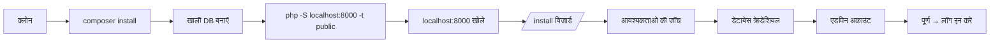

डेवलपमेंट और योगदान के लिए अपनी मशीन पर **OwnPay** चलाएँ - **Windows**, **macOS** या **Linux** पर। पूर्वापेक्षाएँ इंस्टॉल होने के बाद नीचे दिया गया तेज़ तरीका लगभग **2 मिनट** लेता है।

> कोडबेस में नए हैं? पहले **[ARCHITECTURE.md](/hi/resources/architecture)** पढ़ें।

---

## पूर्वापेक्षाएँ {#prerequisites}

| टूल | संस्करण | क्यों | कहाँ से प्राप्त करें |
|------|---------|-----|--------|
| **PHP** | **8.3+** के साथ `bcmath`, `json`, `mbstring`, `openssl`, `pdo`, `pdo_mysql`, `curl` | रनटाइम | [php.net/downloads](https://www.php.net/downloads) · [windows.php.net](https://windows.php.net/download/) |
| **Composer** | 2.x | PHP डिपेंडेंसी | [getcomposer.org/download](https://getcomposer.org/download/) |
| **MySQL** *या* **MariaDB** | MySQL 8.0+ / MariaDB 10.4+ | डेटाबेस | [dev.mysql.com](https://dev.mysql.com/downloads/mysql/) · [mariadb.org](https://mariadb.org/download/) |
| **Git** | कोई भी | रिपॉज़िटरी क्लोन करने के लिए | [git-scm.com/downloads](https://git-scm.com/downloads) |
| **Node.js** *(वैकल्पिक)* | 18+ | केवल JS/CSS लिंटिंग के लिए | [nodejs.org](https://nodejs.org/en/download) |

> **सुझाव:** नीचे दिए गए ऑल-इन-वन स्टैक (Laragon / Herd / Docker) PHP + MySQL + एक वेब सर्वर को एक साथ बंडल करते हैं, ताकि आपको इन्हें अलग से इंस्टॉल न करना पड़े।

अपना PHP संस्करण और एक्सटेंशन जाँचें:

```bash
php -v
php -m
```

---

## क्विक स्टार्ट - सभी प्लेटफ़ॉर्म (~2 मिनट) {#quick-start-all-platforms-~2-minutes}

यह PHP के बिल्ट-इन वेब सर्वर का उपयोग करता है, इसलिए यह Windows, macOS और Linux पर एक जैसा काम करता है। किसी वेब-सर्वर कॉन्फ़िगरेशन की आवश्यकता नहीं है।

```bash
# 1. Clone
git clone https://github.com/own-pay/OwnPay.git
cd OwnPay

# 2. Install PHP dependencies
composer install

# 3. Create an empty database (MySQL example)
mysql -u root -p -e "CREATE DATABASE ownpay CHARACTER SET utf8mb4 COLLATE utf8mb4_unicode_ci;"

# 4. Serve the public/ directory
php -S localhost:8000 -t public
```

अब अपने ब्राउज़र में **[http://localhost:8000](http://localhost:8000)** खोलें। आपको **`/install` विज़ार्ड** पर रीडायरेक्ट किया जाएगा - यह आपकी `.env` फ़ाइल बनाता है, स्कीमा इम्पोर्ट करता है और आपके लिए एडमिन अकाउंट बनाता है। `.env` को मैन्युअल रूप से एडिट करने की आवश्यकता नहीं है।



> इंस्टॉलर `storage/.installed` पर एक लॉक फ़ाइल लिखता है। इंस्टॉलर को दोबारा चलाने के लिए, वह फ़ाइल हटाएँ (और DB को drop/recreate करें)।

---

## प्लेटफ़ॉर्म-विशिष्ट ऑल-इन-वन स्टैक {#platform-specific-all-in-one-stacks}

असली वेब सर्वर और सुंदर `*.test` डोमेन पसंद हैं? एक बंडल्ड स्टैक का उपयोग करें। क्विक स्टार्ट अभी भी लागू होता है - बस स्टैक के वेब रूट को `public/` पर पॉइंट करें।

### 🪟 Windows - Laragon (अनुशंसित) {#🪟-windows-laragon-recommended}

[Laragon](https://laragon.org/download/) PHP, MySQL, Apache/Nginx को बंडल करता है और स्वचालित रूप से `.test` डोमेन बनाता है।

1. Laragon इंस्टॉल करें और उसे शुरू करें (**Start All**)।
2. सुनिश्चित करें कि बंडल्ड PHP **8.3+** है (Menu → PHP → Version)। आवश्यकता हो तो स्विच करें।
3. प्रोजेक्ट को Laragon के `www` फ़ोल्डर में रखें: `C:\laragon\www\ownpay`।
4. Laragon स्वचालित रूप से vhost **`http://ownpay.test`** बनाता है (यदि यह दिखाई न दे तो Menu → **Reload**/**Restart All**)।
5. **HeidiSQL** (बंडल्ड) में डेटाबेस बनाएँ या ऊपर दिया गया `CREATE DATABASE` कमांड चलाएँ।
6. **[http://ownpay.test](http://ownpay.test)** पर जाएँ → इंस्टॉलर विज़ार्ड चलता है।

> Laragon का डॉक्यूमेंट रूट बंडल्ड rewrite नियमों के माध्यम से स्वचालित रूप से प्रोजेक्ट के `public/` पर मैप हो जाता है।

### 🍎 macOS - Laravel Herd (अनुशंसित) {#🍎-macos-laravel-herd-recommended}

[Herd](https://herd.laravel.com/) एक मुफ़्त, वन-क्लिक PHP वातावरण है (PHP + Nginx + `.test` डोमेन के लिए dnsmasq)।

1. Herd इंस्टॉल करें। इसमें PHP 8.3+ और Composer शामिल हैं।
2. प्रोजेक्ट वाले फ़ोल्डर को **Parked** पाथ के रूप में जोड़ें (Herd → Settings → General), या पैरेंट डायरेक्टरी से `herd park` चलाएँ।
3. Herd इसे **`https://ownpay.test`** पर सर्व करता है (Herd साइट को स्वचालित रूप से `public/` पर पॉइंट करता है)।
4. [DBngin](https://dbngin.com/) (मुफ़्त) या Homebrew (`brew install mysql && brew services start mysql`) से MySQL शुरू करें, फिर `ownpay` डेटाबेस बनाएँ।
5. **[https://ownpay.test](https://ownpay.test)** पर जाएँ → इंस्टॉलर विज़ार्ड चलता है।

केवल Homebrew विकल्प: `brew install php@8.3 composer mysql` चलाएँ, फिर **क्विक स्टार्ट** बिल्ट-इन-सर्वर तरीके का उपयोग करें।

### 🐧 Linux - नेटिव पैकेज {#🐧-linux-native-packages}

```bash
# Debian / Ubuntu
sudo apt update
sudo apt install -y php8.3-cli php8.3-mysql php8.3-mbstring php8.3-bcmath \
                    php8.3-curl php8.3-xml unzip mariadb-server composer

sudo systemctl start mariadb
sudo mysql -e "CREATE DATABASE ownpay CHARACTER SET utf8mb4 COLLATE utf8mb4_unicode_ci;"

git clone https://github.com/own-pay/OwnPay.git && cd OwnPay
composer install
php -S localhost:8000 -t public
```

(Fedora: `sudo dnf install php-cli php-mysqlnd php-mbstring php-bcmath php-json composer mariadb-server`।)

प्रोडक्शन जैसे Nginx/Apache vhost के लिए, डॉक्यूमेंट रूट को `public/` पर पॉइंट करें और सभी अनुरोधों को `public/index.php` पर रूट करें (एक Apache `.htaccess` पहले से शामिल है; रिपॉज़िटरी रूट में एक `nginx.conf.example` दिया गया है)।

---

## इंस्टॉल के बाद - अपना सेटअप सत्यापित करें {#after-install-verify-your-setup}

वही जाँचें चलाएँ जो CI करता है:

```bash
composer test       # PHPUnit
composer analyse    # PHPStan (level 9)
composer lint       # Twig + JS + CSS lint  (Node required for js/css)
```

एक साफ़ checkout पर तीनों पास होनी चाहिए।

---

## वैकल्पिक: लोकल पेमेंट-गेटवे कॉलबैक {#optional-local-payment-gateway-callbacks}

बाहरी गेटवे (bKash, Stripe आदि) `localhost`/`*.test` तक नहीं पहुँच सकते। असली रीडायरेक्ट/वेबहुक का परीक्षण करने के लिए, अपने लोकल सर्वर को एक टनल के साथ एक्सपोज़ करें और `.env` में `GATEWAY_CALLBACK_URL` सेट करें:

```bash
# example with ngrok (https://ngrok.com/download)
ngrok http 8000
# then in .env:  GATEWAY_CALLBACK_URL=https://<your-id>.ngrok-free.app
```

---

## समस्या निवारण {#troubleshooting}

| लक्षण | समाधान |
|---------|-----|
| `/install` कहता है कि कोई एक्सटेंशन मौजूद नहीं है | सूचीबद्ध `php-*` एक्सटेंशन इंस्टॉल करें और सर्वर रीस्टार्ट करें। `php -m` से दोबारा जाँचें। |
| `composer install` `ext-*` पर विफल होता है | आपके CLI PHP में कोई एक्सटेंशन नहीं है। उसे इंस्टॉल करें (जैसे `php8.3-bcmath`) - ध्यान दें कि **CLI** php.ini वेब वाले से अलग हो सकती है। |
| विज़ार्ड में "Could not connect to database" | पुष्टि करें कि MySQL चल रहा है और DB मौजूद है; macOS/Linux पर डिफ़ॉल्ट यूज़र अक्सर `root` होता है, जिसका पासवर्ड खाली या socket होता है। |
| खाली पेज / बिना विवरण के 500 | विस्तृत डेव एरर पेज के लिए `.env` में `APP_DEBUG=true` सेट करें (प्रोडक्शन में कभी नहीं), `storage/logs/` जाँचें। |
| पूरा होने के बाद भी इंस्टॉलर रीडायरेक्ट करता रहता है | `storage/.installed` केवल तभी हटाएँ जब आप दोबारा इंस्टॉल करना चाहते हों; अन्यथा `storage/cache/` साफ़ करें। |
| `.env`/`storage/` लिखते समय अनुमति त्रुटियाँ | सुनिश्चित करें कि प्रोजेक्ट रूट और `storage/` आपके यूज़र / वेब-सर्वर यूज़र द्वारा लिखने योग्य हैं। |

---

## प्रोजेक्ट लेआउट और कहाँ से शुरू करें {#project-layout-&-where-to-start}

पूरे मैप के लिए **[ARCHITECTURE.md](/hi/resources/architecture)** देखें। अधिकांश योगदान इन्हें छूते हैं:

- `src/Controller/` - HTTP हैंडलर
- `src/Service/` - बिज़नेस लॉजिक
- `src/Repository/` - डेटा एक्सेस
- `modules/gateways/` - पेमेंट इंटीग्रेशन ([Plugin Developer Guide](https://learn.ownpay.org/plugins-developer-guide) देखें)
- `templates/` - Twig व्यूज़

हैप्पी हैकिंग! 🚀
