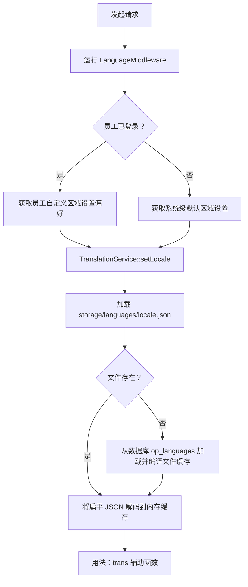

OwnPay 拥有一套国际化（i18n）和本地化架构，可提供本地化的管理面板以及白标、面向客户的结账界面。本指南介绍翻译系统、区域设置解析流程、在 PHP 代码和 Twig 模板中的用法，以及如何贡献或管理翻译目录。

---

## 1. 核心架构 {#1-core-architecture}

OwnPay 对语言翻译文件采用**数据库与文件系统**混合存储模式，以确保结账热路径中的高性能，同时允许在管理面板中进行动态的运行时调整。



### 1.1 翻译存储 {#1-1-translation-storage}
* **数据库表（`op_languages`）**：
  存储语言配置和翻译目录。包含以下列：
  * `code`（VARCHAR）：ISO 639-1 语言代码（例如 `en`、`bn`、`es`）。
  * `name`（VARCHAR）：便于阅读的语言名称（例如 `English`、`Bengali`、`Spanish`）。
  * `status`（ENUM）：语言状态（`active`、`inactive`）。系统只能解析处于激活状态的语言。
  * `is_default`（TINYINT）：标识系统级回退默认语言。
  * `translations`（JSON）：扁平翻译键值映射的目录。
* **文件系统编译（`storage/languages/`）**：
  为避免在高吞吐量支付结账中产生数据库查询开销，当在管理面板中创建、上传或保存语言时，翻译会被即时编译到 `storage/languages/{code}.json`。
* **英语基础回退（`config/languages/`）**：
  英语（`en`）作为基础默认区域设置和回退语言。主文件维护在 `config/languages/en.json`。如果编译后的文件系统缓存 `storage/languages/en.json` 缺失或被删除，系统会通过复制 `config/languages/en.json` 的内容自动恢复它。

---

## 2. 区域设置解析管道 {#2-locale-resolution-pipeline}

区域设置解析由 [LanguageMiddleware](https://github.com/own-pay/OwnPay/blob/main/src/Middleware/LanguageMiddleware.php) 在 HTTP 请求生命周期中管理：

1. **全局默认检查**：通过在数据库中查询激活的默认语言来解析系统默认语言（未指定时回退到 `en`）。
2. **员工用户偏好**：如果有管理员工用户登录，中间件会查询 `op_merchant_users` 表的 `language` 列，获取其明确的用户偏好。
3. **上下文绑定**：解析出的区域设置通过 `setLocale()` 绑定到 `TranslationService`，并清除任何过期的内存翻译缓存。

---

## 3. 翻译键格式 {#3-translation-key-formatting}

OwnPay 强制翻译键使用扁平的点号表示法格式。

### 3.1 点号表示法 {#3-1-dot-notation}
通过嵌套 JSON 结构上传的语言数组会自动使用点号表示法扁平化为单层键值映射。例如，以下嵌套 JSON：
```json
{
    "menu": {
        "dashboard": "Dashboard",
        "payments": "Payments"
    },
    "common": {
        "actions": {
            "save": "Save Changes"
        }
    }
}
```
会被扁平化并在内部存储为：
```json
{
    "menu.dashboard": "Dashboard",
    "menu.payments": "Payments",
    "common.actions.save": "Save Changes"
}
```

### 3.2 占位符与替换 {#3-2-placeholders-&-replacements}
翻译字符串中的动态参数以前导冒号（`:`）标识。
```json
{
    "language.confirm_delete": "Are you sure you want to delete :name?",
    "payment.charge_success": "Successfully charged :amount :currency"
}
```

---

## 4. 在 PHP 代码中使用 {#4-usage-in-php-code}

要在 PHP 类（控制器、服务、仓库）中使用翻译，请从 PSR-11 依赖容器中获取 [TranslationService](https://github.com/own-pay/OwnPay/blob/main/src/Service/System/TranslationService.php)：

```php
declare(strict_types=1);

namespace OwnPay\Controller\Admin;

use OwnPay\Http\Request;
use OwnPay\Http\Response;
use OwnPay\Service\System\TranslationService;

final class SettingsController extends BaseController
{
    public function save(Request $req): Response
    {
        /** @var TranslationService $transSvc */
        $transSvc = $this->c->get(TranslationService::class);

        // Simple translation lookup
        $successMsg = $transSvc->trans('language.success_save');

        // Translation lookup with placeholder replacements
        $deleteConfirm = $transSvc->trans('language.confirm_delete', [
            'name' => 'Bengali'
        ]);

        $this->session->flashSuccess($successMsg);
        return Response::redirect('/admin/settings/language');
    }
}
```

### 4.1 回退规则 {#4-1-fallback-rules}
调用 `$translationService->trans($key)` 时：
1. 在当前区域设置（例如 `bn`）的缓存翻译中查找。
2. 如果该键缺失或为空，则回退到英语（`en`）基础目录。
3. 如果英语中也缺少该键，则返回字面量 `$key` 字符串。

---

## 5. 在模板和结账主题中使用 {#5-usage-in-templates-&-checkout-themes}

### 5.1 管理模板 {#5-1-admin-templates}
管理视图使用运行时加载的基础翻译。你可以直接在 Twig 模板中绑定翻译字符串。

### 5.2 结账模板 {#5-2-checkout-templates}
结账视图（例如 `templates/checkout/checkout.twig`）是白标界面，商户可以在其中自定义标准文案。
* 面向客户的模板通过 `lang` 视图变量访问翻译和品牌字符串：
  ```twig
  <p class="st-subtitle">
      {{ lang.success_msg ?? 'Your transaction has been processed successfully.' }}
  </p>
  ```
* 这些变量由 [BrandThemeService](https://github.com/own-pay/OwnPay/blob/main/src/Service/Brand/BrandThemeService.php) 根据当前品牌配置、元数据覆盖或系统级默认设置填充。

---

## 6. 翻译管理 {#6-translation-administration}

超级管理员可以在管理侧边栏的 **System → Settings → Language** 下管理本地化设置：

1. **选择默认语言**：为所有未设置特定员工区域设置覆盖的会话设置默认回退语言。
2. **手动添加语言**：注册新的语言配置。系统会通过克隆默认英语（`en`）字符串来初始化该语言的翻译目录。
3. **上传翻译文件**：导入包含翻译字符串的 JSON 文件（支持扁平或嵌套字典）。
4. **翻译字符串（内联编辑器）**：一个交互式键值表单，可逐行编辑翻译。
5. **删除语言**：除基础英语（`en`）配置外，所有语言均可删除。删除语言会从数据库中删除相应记录，并移除其文件系统缓存文件。

---

## 7. 贡献翻译 {#7-contributing-translations}

提交用于添加或更新语言翻译的 pull request 时：

### 第 1 步：创建翻译目录 {#step-1-create-the-translation-catalog}
使用点号表示法创建翻译 JSON 文件。占位符（以 `:` 为前缀）必须保持不变（例如 `:name`、`:amount` 必须保留冒号）。
示例 `es.json`（西班牙语）：
```json
{
    "menu.dashboard": "Tablero",
    "common.save": "Guardar cambios",
    "language.confirm_delete": "¿Está seguro de que desea eliminar :name?"
}
```

### 第 2 步：测试目录 {#step-2-test-the-catalog}
1. 通过设置中的 **Upload Translation File** 面板上传你的 JSON 文件。
2. 确认字符串在整个管理界面中显示正确。
3. 在 **Account → My Account** 下将你的员工用户语言切换为新上传的语言，以验证按用户的中间件解析。

### 第 3 步：更新默认配置（适用于核心语言） {#step-3-update-default-config-for-core-languages}
如果你贡献的翻译应随 OwnPay 原生发布，请将文件放在你分支的 `config/languages/` 目录中（例如 `config/languages/es.json`），并在 GitHub 上提交 pull request。
