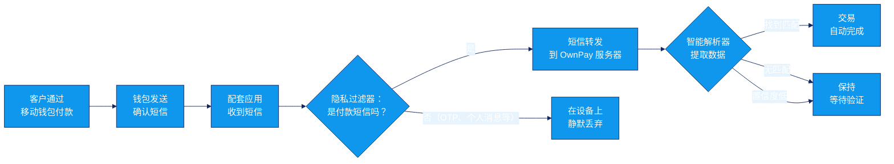

短信自动验证让 OwnPay 无需您动手即可确认手动付款。当客户通过移动钱包或银行付款时，付款确认短信会被转发到 OwnPay，经过解析后与待处理的交易进行匹配。

<Note>
  **隐私范围：**配套应用只转发看起来像付款交易确认的**收到的**短信（例如 bKash/Nagad/Rocket 收款通知）。它会应用**设备端隐私过滤器**，静默丢弃所有其他短信——包括 OTP 验证码、其他服务的验证码、推广信息和个人消息。这些非付款短信**绝不会发送到您的 OwnPay 服务器**。
</Note>

## 工作原理 {#how-it-works}

1. 客户完成付款并在结账时提交交易 ID。
2. 钱包提供商向运行配套应用的手机发送确认短信。
3. 配套应用应用其设备端隐私过滤器。只有符合付款收据模式的短信才会被转发；所有其他短信（OTP、个人、推广）都会在设备上被静默丢弃。
4. 配套应用将过滤后的付款短信转发到您的 OwnPay 服务器。
5. 智能解析器从短信文本中提取**金额**和**交易 ID**。
6. OwnPay 将提取的数据与待处理交易进行匹配。
7. 如果金额和交易 ID 以足够的置信度匹配，交易将自动完成。

## 前提条件 {#prerequisites}

在设置短信验证之前，您需要：

- 在 Android 手机上安装 **OwnPay 配套应用**——请参阅[配套应用](/zh/mobile/companion-app)。
- 设备已与您的 OwnPay 服务器**配对**——请参阅[已配对设备](/zh/mobile/devices)。
- 在配套应用设置中**启用**短信转发。
- 至少有一个手动网关开启了 **Enable SMS Verification**。

## 智能解析器 {#smart-parser}

智能解析器结合使用正则表达式模式和启发式规则，从短信中提取付款数据。它不需要外部 AI 服务。

- **正则模板**——您可以在[短信模板](/zh/mobile/sms-templates)中为每个网关定义模式。每个模板指定如何提取金额、交易 ID 和发送方。
- **启发式规则**——当没有模板匹配时，解析器会使用内置规则识别常见的短信格式（例如"Tk 500 received from..."）。
- **置信度评分**——每个解析结果都会获得一个置信度分数。只有高于阈值的匹配才会自动完成。低置信度的匹配会保持在等待验证状态，以供人工审核。

## 支持的网关 {#supported-gateways}

| 网关 | 短信解析 | 是否提供模板 | 备注 |
| --- | --- | --- | --- |
| **bKash** | 是 | 是 | 经过充分测试，置信度高 |
| **Nagad** | 是 | 是 | 经过充分测试，置信度高 |
| **Rocket** | 是 | 是 | 已包含模板 |
| **Upay** | 是 | 是 | 已包含模板 |
| **银行转账（通用）** | 部分 | 否 | 需要自定义模板 |

对于未列出的网关，您可以创建自定义短信模板——请参阅[短信模板](/zh/mobile/sms-templates)。

## 故障排查 {#troubleshooting}

| 问题 | 原因 | 解决方案 |
| --- | --- | --- |
| 交易未自动完成 | 配套应用离线或短信转发已禁用 | 在 Paired Devices 页面上检查设备状态 |
| 提取的金额错误 | 正则模板与短信格式不匹配 | 编辑短信模板并使用示例消息进行测试 |
| 找到匹配但置信度过低 | 网关更新后短信格式发生变化 | 更新正则模板以匹配新格式 |
| 重复短信导致重复匹配 | 同一条短信被多次转发 | 系统会按交易 ID 去重；如果问题仍然存在，请检查配套应用设置 |

## 相关页面 {#related-pages}

- [短信模板](/zh/mobile/sms-templates) - 创建和管理解析模板
- [配套应用](/zh/mobile/companion-app) - 安装和配置 Android 应用（仅转发收到的付款短信）
- [已配对设备](/zh/mobile/devices) - 将手机与服务器配对
- [手动方式](/zh/gateways/manual-methods) - 创建已启用短信验证的手动网关
