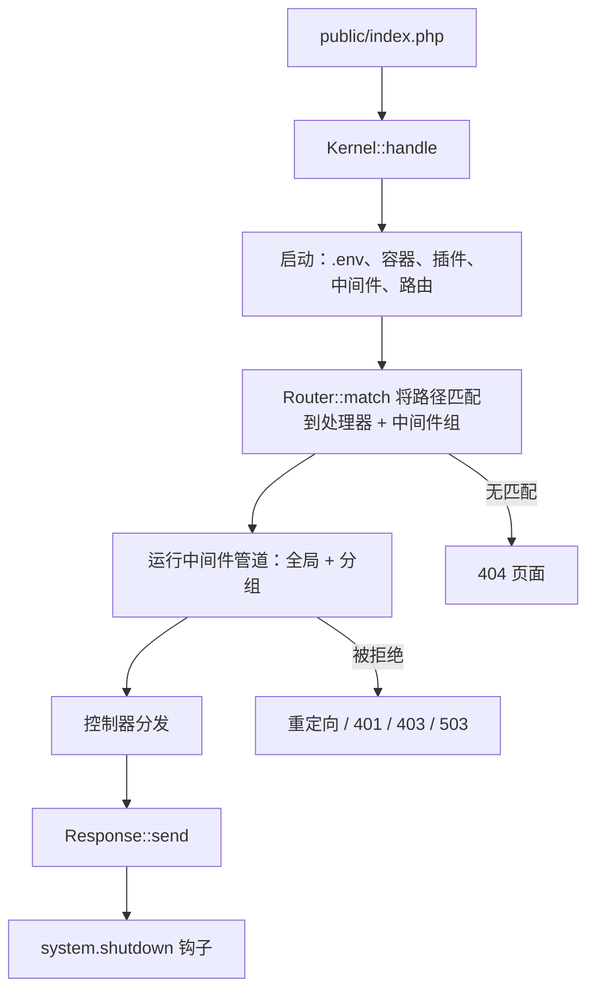
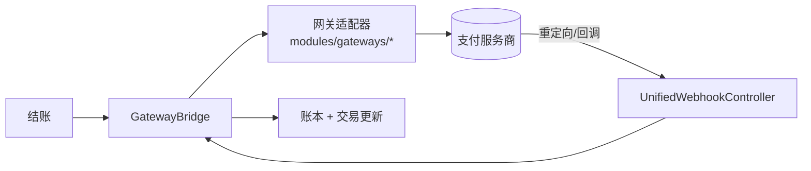

一份介绍 **OwnPay** 构建方式的开发者指南，面向贡献者和集成者。

OwnPay 是一个使用现代 PHP（8.3+）编写的**自托管、单一所有者、多品牌支付编排器**。由一位管理员运行平台并创建多个**品牌**（商店）；每个品牌拥有自己的域名、网关、客户和账本，所有数据都通过 `merchant_id` 列隔离在同一个 MySQL 数据库中。它**不是**多租户 SaaS，没有公开注册入口。

> 想先在本地运行？请参阅 **[LOCAL_SETUP.md](/zh/resources/local-setup)**。

---

## 1. 技术栈一览 {#1-tech-stack-at-a-glance}

| 层 | 选择 |
|-------|--------|
| 语言 | PHP 8.3+（所有文件均使用 `declare(strict_types=1)`） |
| 持久化 | MySQL 8 / MariaDB 10.4+（PDO，仅使用预处理语句） |
| 模板 | Twig 3+ |
| 前端控制器 | 单一入口 `public/index.php` |
| 依赖注入 | 自定义 PSR-11 容器（`src/Container.php`），支持反射自动装配 |
| 身份验证（移动端/API） | `firebase/php-jwt` |
| 前端 | 服务端渲染的 Twig + 原生 CSS/JS（无 SPA 构建步骤） |
| 依赖 | 刻意保持最少，参见 `composer.json` |
| 静态分析 | PHPStan **level 9** |
| 测试 | PHPUnit |

**没有使用框架**（没有 Laravel/Symfony 运行时）。内核、路由器、容器和中间件管道都是位于 `src/` 下的小巧、易读的自有代码。

---

## 2. 请求生命周期 {#2-request-lifecycle}

每个 HTTP 请求都经过同一个前端控制器和 `Kernel`：



### 启动顺序（`Kernel::boot()`） {#boot-sequence-kernelboot}

1. 加载 `.env`（`vlucas/phpdotenv`）。
2. 根据 `config/services.php` 构建 DI 容器。
3. 设置时区。
4. **启动插件**（`PluginLoader::boot()`）——在中间件*之前*执行，以便插件可以通过 `system.middleware.pipeline` 过滤器注入中间件。
5. 从 `config/middleware.php` 加载中间件管道并应用插件过滤器。随后会重新确认安全关键的管理中间件，插件无法将其移除。
6. 触发 `system.boot` 动作。
7. 从 `config/routes/web.php` + `config/routes/api.php`（+ 插件路由）加载路由。
8. 匹配请求，运行其中间件组，分发控制器。
9. 发送响应。
10. 触发 `system.shutdown`。

如果应用尚未安装，所有请求都会重定向到 `/install`。错误页和维护页由无依赖的 `ErrorPageRenderer`（`src/View/`）渲染，因此即使 Twig 或数据库不可用，它们仍能正常工作。

---

## 3. 目录结构 {#3-directory-map}

```text
ownpay/
├── public/            # Web root - index.php + static assets (only PHP file here)
├── src/               # All application code (PSR-4: OwnPay\ → src/)
│   ├── Kernel.php         # Boot + dispatch orchestrator
│   ├── Container.php      # PSR-11 DI container
│   ├── Http/              # Request, Response, Router
│   ├── Middleware/        # Auth, CSRF, CORS, rate limit, domain, security headers…
│   ├── Controller/        # Admin/, Api/, Checkout/, Page/, Webhook/, Install/
│   ├── Repository/        # Data access; BaseRepository + TenantScope trait
│   ├── Service/           # Business logic (Payment, Brand, Domain, Device, System…)
│   ├── Gateway/           # Gateway adapter interface + bridge + webhook processor
│   ├── Plugin/            # Plugin loader, registry, manifest, sandbox scanner
│   ├── Event/             # EventManager (WordPress-style actions + filters)
│   ├── Security/          # SecurityHelpers, UrlValidator (SSRF guards)…
│   ├── View/              # Twig factory, extensions, ErrorPageRenderer
│   ├── Cron/              # Scheduled jobs (queue worker, webhook retry, currency���)
│   └── Update/            # Self-update engine (download, verify, extract, migrate)
├── config/            # app.php, services.php, middleware.php, hooks.php, routes/
├── modules/           # gateways/, addons/, themes/ (one dir each, manifest.json)
├── templates/         # Twig templates (admin, checkout, error, emails…)
├── database/          # schema.sql + migrations/
├── vendor/            # vendor
└── docs/              # docs
```

---

## 4. 核心子系统 {#4-core-subsystems}

### 4.1 依赖注入（`src/Container.php`） {#4-1-dependency-injection-src/container-php}
符合 PSR-11 标准。服务在 `config/services.php` 中显式绑定；任何未绑定的服务都通过反射解析（构造函数自动装配）。支持共享单例和瞬态绑定。

### 4.2 仓库与品牌隔离 {#4-2-repositories-&-brand-isolation}
数据访问位于 `src/Repository/` 中，构建在 `BaseRepository` 之上。品牌隔离由 `TenantScope` trait **在查询层面**强制执行：

```php
// Scoped to the active brand (safe default)
$invoices = $this->invoiceRepo->forTenant($brandId)->paginateScoped($page, $perPage);

// Explicit global view for owner-level pages
$all = $this->invoiceRepo->forAllTenants()->paginate();
```

每个限定范围的实体表都带有 `merchant_id` 列。**切勿**在没有 `forTenant()`（或有意使用的 `forAllTenants()`）的情况下运行限定范围的查询。

### 4.3 复式记账账本 {#4-3-double-entry-ledger}
资金流动以平衡的借方/贷方形式记录在 `op_ledger_accounts`、`op_ledger_transactions` 和 `op_ledger_entries` 中。余额遵循标准会计方向（资产/费用在借方增加；负债/权益/收入在贷方增加）。所有货币计算都使用 **bcmath 字符串**，绝不使用浮点数。

### 4.4 事件与插件 {#4-4-events-&-plugins}
`EventManager` 提供 WordPress 风格的**动作**（`doAction`）和**过滤器**（`applyFilter`）。插件位于 `modules/` 中，并在这些钩子上注册回调。请参阅 [Hooks Reference](https://learn.ownpay.org/hooks-reference) 和 [Plugin Developer Guide](https://learn.ownpay.org/plugin-developer-guide)。

插件通过 `manifest.json` 被发现，经过**静态代码扫描器**（`PluginSandbox`）检查，该扫描器会拒绝危险调用（`exec`、`shell_exec`、`passthru`、`eval`、`system`、原始 PDO/反射），检查通过后才会被加载。

### 4.5 白标自定义域名*（业界首创）* {#4-5-white-label-custom-domains-industry-first}
OwnPay 是**首个**在单一安装上支持按品牌自定义域名结账的**自托管支付平台**。品牌可以映射自己的域名（例如 `pay.yourbrand.com`），经过 DNS 验证（TXT 所有权 + A 记录路由）后完全激活。从那时起，所有面向客户的 URL 都使用该品牌的域名，客户看到的是品牌的标志、名称和颜色，不会出现任何 OwnPay 的痕迹。

`DomainMiddleware` 根据 `op_domains` 表解析 `HTTP_HOST`，注入 `merchant_id`，并在自定义域名上阻止 `/admin/*`。**始终**通过 `DomainUrlService`（`buildCheckoutUrl()`、`buildCallbackUrl()`）构建面向客户和网关的 URL，切勿硬编码主机名。

### 4.6 支付网关 {#4-6-payment-gateways}
网关是实现 `GatewayAdapterInterface`（`src/Gateway/`）的插件：

```php
interface GatewayAdapterInterface {
    public function slug(): string;
    public function initiate(array $params, array $credentials): array;
    public function verify(array $callbackData, array $credentials): array;
    public function verifyWebhook(string $rawBody, array $headers, array $credentials): bool;
    public function refund(string $gatewayTrxId, string $amount, array $credentials): array;
    public function supports(string $feature): bool;
    public function supportedCurrencies(): array; // [] = any currency
}
```

`GatewayDefaults` trait 提供合理的空操作默认实现，因此适配器只需实现它所支持的功能。在结账时，意向货币会通过 `CurrencyService` 使用 `op_exchange_rates` 自动转换为网关支持的货币，转换的审计记录会保存在交易元数据中。



### 4.7 配置与设置 {#4-7-configuration-&-settings}
运行时设置存储在 `op_system_settings` 中（group/key/value，可选 `merchant_id` 用于按品牌覆盖）。通过 `EnvironmentService` / `SettingsRepository` 访问它们；当没有存储值时，`EnvironmentService::get()` 会回退到操作系统环境变量。没有单独的配置存储。

### 4.8 自我更新 {#4-8-self-update}
`src/Update/UpdateService.php` 执行原子化、可安全回滚的更新：获取清单 → 备份 → 进入维护模式 → 下载（GitHub release 资产）→ **验证 SHA-256 + RSA 签名** → 解压（带 zip-slip 防护）→ 运行迁移 → 健康检查 → 退出维护模式。同一个 release zip 也可以用作全新安装的归档包。

---

## 5. 安全模型 {#5-security-model}

OwnPay 将所有外部输入视为恶意输入。贡献者必须遵守的要点：

- **SQL**：仅使用预处理语句（`Database` 封装）。禁止字符串插值拼接 SQL。
- **输出**：开启 Twig 自动转义；切勿对不可信数据使用 `|raw`。
- **CSRF**：所有非 API 的修改操作都使用 `CsrfMiddleware`；令牌通过 `SecurityHelpers::csrfToken()` 获取。
- **密码**：Argon2id / bcrypt。**API 密钥**：192 位随机值，以 SHA-256 哈希形式存储，仅显示一次。
- **身份验证/授权层级**（参见 `config/middleware.php`）：管理后台使用 Web 会话；商户 API 使用 **Bearer API 密钥**（读/写范围）；管理 API 使用**管理员范围**的 Bearer 密钥；移动配套 API 使用 **JWT**。
- **速率限制**：`RateLimiterMiddleware`；身份验证敏感端点（登录、2FA、设备配对）使用严格的限流桶。
- **SSRF**：外发 webhook 会解析并**固定**一个经过验证的公网 IP（`UrlValidator::resolveSafeWebhookIp`），且绝不跟随重定向。
- **标头**：通过 `SecurityHeadersMiddleware` 设置 CSP（带每请求 nonce）、HSTS、`X-Frame-Options`、`X-Content-Type-Options`。
- **机密信息**（`.env`、签名密钥）绝不提交到代码库，也绝不包含在 release zip 中。

---

## 6. API 接口 {#6-api-surface}

三个独立的 API 层，每层都有自己的中间件组和身份验证：

| 层 | 前缀 | 身份验证 | 定义位置 |
|-------|--------|------|-----------|
| 商户 REST | `/api/v1/*` | Bearer API 密钥（读/写范围） | `config/routes/api.php` |
| 移动配套 | `/api/mobile/v1/*` | JWT（设备配对后） | 同上 |
| 管理 API | `/api/admin/v1/*` | 带有 `admin` 范围的 Bearer API 密钥（按商户） | 同上 |

正式 API 结构：**[docs.ownpay.org](https://docs.ownpay.org)**。集成示例和指南：**[learn.ownpay.org](https://learn.ownpay.org)**。

---

## 7. 贡献者约定 {#7-conventions-for-contributors}

1. `declare(strict_types=1);` 是每个 PHP 文件的第一行（无 BOM）。
2. 保持 PHPStan 在 **level 9**，推送前运行 `composer analyse`。
3. 金额使用 **bcmath 字符串**，绝不使用浮点数。
4. 限定范围的数据库访问始终通过 `forTenant()` / `*Scoped()`。
5. 客户/网关 URL 始终通过 `DomainUrlService` 构建，切勿硬编码主机名。
6. 新增网关？在 `modules/gateways/<slug>/` 下添加一个目录，其中包含 `manifest.json` 和实现 `GatewayAdapterInterface` 的适配器。请参阅 [Plugin Developer Guide](https://learn.ownpay.org/plugin-developer-guide)。
7. 提交 PR 前运行完整检查：`composer test && composer analyse && composer lint`。

---

**另请参阅：**[功能参考 →](/zh/resources/features) 了解 OwnPay 的完整功能列表 · [本地设置 →](/zh/resources/local-setup) · [learn.ownpay.org](https://learn.ownpay.org) 获取集成指南。

---

❤️ 由**社区**打造，为**社区**服务。
